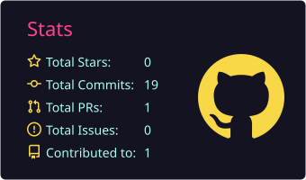

# Hola, soy Nicolás Pérez 👋

### Estudiante de Ingeniería del Software Universidad de Oviedo

Soy un futuro ingeniero enfocado en el **desarrollo de software riguroso**. Mi filosofía de trabajo se aleja del "vibe coding": priorizo la comprensión profunda de la arquitectura, el código limpio y la supervisión técnica estricta, especialmente al integrar herramientas de IA en el flujo de desarrollo.

---

### 🌐 Conecta conmigo

  
  
  
  

---

### 🛠️ En qué estoy trabajando
- 🎓 Cursando 3.er año en la **Universidad de Oviedo**, profundizando en algoritmos, estructuras de datos y paradigma funcional.
- 🌱 Desarrollando [**padel-booking-api**](https://github.com/nicoprezz/padel-booking-api), una API REST para la reserva de pistas de pádel con **Spring Boot**.
- 🤖 Explorando la integración controlada de la **IA** para optimizar tareas de desarrollo sin perder el rigor técnico.
- 🔐 Interesado en la **Ciberseguridad**, el diseño de **APIs REST con Spring Boot** y la construcción de sistemas robustos y escalables.

### 💻 Dev Stack & Tools

  
  
  
  
  
  
  
  
  
  
  
  
  
  
  
  
  
  
  

---

### 📊 Estadísticas y Actividad

  

   
  

---

> *"La calidad del software no es una opción, es una responsabilidad técnica."*
